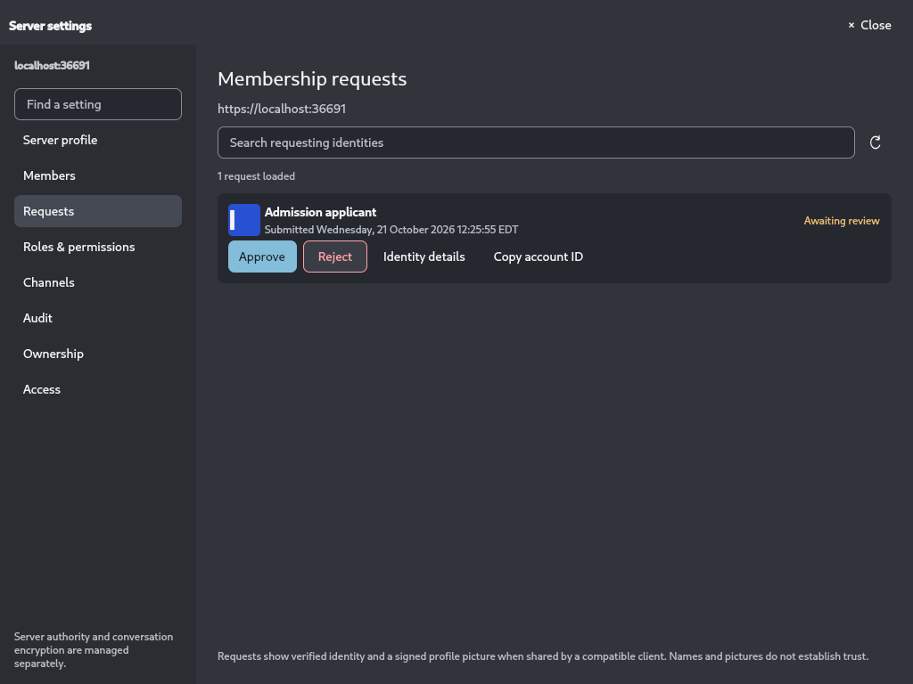

# Membership request profile pictures — 2026-10-21

## Plan

Trace the existing signed-profile and request paths; add bounded pre-admission
profile transport; connect verified pictures to the native request row; validate
each layer with protocol checks and independent clients on `192.168.86.54`.
The user explicitly approved sharing signed profile pictures with staff before
approval. See [ADR 0013](../adr/0013-admission-profile-pictures.md).

## Implementation

The request API previously carried only the certified device and signed name.
The QML avatar consequently had no image source. New requests on compatible
clients/servers carry a bounded copy of complete signed account presentation
history and the agreed JPEG XL image. Staff retrieve the snapshot separately
from queue pagination, under current management authorization. Both endpoints
and clients validate their applicable identity, signature, ancestry and image
boundaries; the server additionally validates media through the existing sandbox.
Incoming body staging shares the bounded validation semaphore and has a timeout.

Snapshots remain request-scoped. They grant no session, directory membership,
channel permission, or MLS access. Approval clears the snapshot and ordinary
profile publication remains independent. Reviewers merge signed history into
their existing account vault cache, preserving newer known profiles under replay.

Visible request rows load pictures on demand, preserve circle/square shape and
row-hover playback, and reuse the bounded native image cache. Refresh retries
loads. Initials remain the fallback where no picture was provided. Joining UI
discloses sharing public presentation with staff. Existing layout is preserved.

Deploy matching client/server updates and PostgreSQL migration
`202610210001_admission_profiles.sql` (schema 18). Existing requests without a
snapshot require the applicant to submit/check the request again with an updated
client, followed by staff Refresh. Unsupported peers omit the optional upload;
legacy queue reads omit the new availability field. No production deployment or
running-package replacement was performed.

## Validation

- Protocol suite: 18 unit tests and the independent identity vector test passed.
- Rust client, server and native bridge library/test checks passed.
- Windows MSVC Release client build passed, producing
  `E:/CordsBuild/build/Release/Cords.exe`. Its SHA-256 and build log path are in
  the validation JSON. Qt headers emitted C4702 warnings. This is build evidence;
  the Windows GUI and installed package were not exercised or replaced.
- Qt 6.10.3 Linux build and generated-import QML lint passed. Existing unused
  imports were reported as informational messages.
- Real PostgreSQL 17 and verified TLS on `192.168.86.54`:
  `admission_picture_two_clients_before_approval_and_restart` passed. Coverage:
  pre-approval picture retrieval; pending picture update; replay preserving the
  newer cached profile; denied unauthenticated/pending access; duplicate request
  stability; reopening two independent vaults; forged-signature rejection;
  clearing the approved request; normal post-approval publication.
- Native Qt, Linux offscreen/software rendering, on the same host:
  `liveAdmissionWorkflow` passed with an actual pending picture, exact image
  source, square shape, decoder readiness, and row-hover playback assertions;
  reject/resubmit/approve and public-history behavior remained working.
  `productionQmlHoverProfilesAndLayouts` and `conversationEmptyHistoryStates`
  also passed. This is native offscreen evidence, not Windows GUI acceptance.
- `git diff --check` passed.
- Strict Clippy remains blocked by pre-existing warnings in avatar encoding,
  bridge avatar/runtime code, server presentation and existing tests. Warnings
  introduced by this change were fixed; lint warnings were not globally disabled.

The first debug HTTP test timed out while Wasmtime compiled its sandbox for the
first time. Test setup now initializes the real sandbox before issuing expiring
device challenges. Cold debug initialization is excluded from HTTP-flow timing;
this does not prove production cold-start latency. The first native harness
attempt required unavailable `xvfb-run`; the final test uses Qt's offscreen plugin
without installing packages or changing the host display configuration.

Evidence: [validation JSON](evidence/admission-pfp-20261021/validation.json),
[two-client JUnit](evidence/admission-pfp-20261021/two-client.xml),
[two-client log](evidence/admission-pfp-20261021/two-client.txt),
[native JUnit](evidence/admission-pfp-20261021/native-admission.xml),
[native log](evidence/admission-pfp-20261021/native-admission.txt),
[native regression JUnit](evidence/admission-pfp-20261021/native-regressions.xml).
The isolated source, service logs, build logs and stopped disposable PostgreSQL container
are retained under `cords-e2e-admission-pfp-20261021-b185` on the E2E host.

